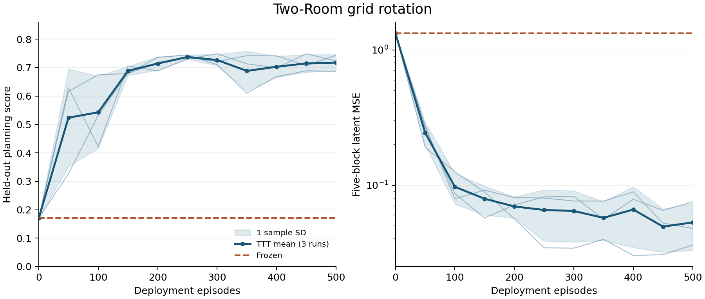

# JEPA-TTT reproduction

Independent implementation of the **Two-Room** experiments from *JEPA-TTT: Persistent Test-Time Training of Latent World Models for Planning under Dynamics Shifts* by Zheyuan Zhang et al. A pretrained action-conditioned LeWorldModel adapts its dynamics predictor using RGB observations and executed actions. A frozen, offline-trained reward head scores plans during deployment. [Paper](https://arxiv.org/abs/2610.00722) · [Authors' project page](https://jepa-ttt.github.io/)

## Results

Each run starts from the same world model and reward head. We report the mean and sample standard deviation over three separately seeded deployment runs. For each shift, we evaluate every 50 episodes on the same 100 held-out starts. The fixed-trajectory prediction test uses a separate set of 100 trajectories from the frozen controller.

| Dynamics shift | Source | Frozen score ↑ | Best TTT score ↑ | TTT score AUC ↑ | Five-block latent MSE, frozen → adapted ↓ | MSE reduction ↑ |
|---|---|---:|---:|---:|---:|---:|
| Grid rotation | Paper | 0.211 | 0.799 ± 0.003 | 0.725 ± 0.019 | 1.48501 → 0.02205 | 98.52% |
| Grid rotation | This reproduction | 0.170 | 0.737 ± 0.007 | 0.648 ± 0.034 | 1.33103 → 0.05304 | 96.02% |
| Spatial wave | Paper | 0.557 | 0.799 ± 0.002 | 0.728 ± 0.012 | 1.74541 → 0.18697 | 89.29% |
| Spatial wave | This reproduction | 0.444 | 0.736 ± 0.006 | 0.596 ± 0.016 | 1.62204 → 0.18579 | 88.55% |

Best score uses the maximum of the three-run mean curve at episodes 50–500. AUC uses the trapezoid rule over episodes 0–500, divided by 500. We use the terminal task score for planning comparisons and also log peak scores and strict goal hits. The paper reference values come from [Appendix A4](https://arxiv.org/pdf/2610.00722#page=23) and [Appendix A5](https://arxiv.org/pdf/2610.00722#page=26). Independently pretrained models have different latent coordinates, so relative MSE reduction compares prediction accuracy within each model.

[Grid rotation evaluations and learning curves](results/two-room-grid) · [Spatial wave evaluations and learning curves](results/two-room-wave)



## Reproduce

Check the published metrics on a CPU with Python 3.11 and its standard library:

```bash
python scripts/check_results.py
```

For training and deployment, use Linux, Python 3.11, Git, and a CUDA GPU with bfloat16 support. The runs reported here used one RTX A6000. Set up the environment and fetch the exact upstream revisions:

```bash
git clone https://github.com/ZhengQingJing/jepa-ttt-reproduction.git
cd jepa-ttt-reproduction
python3.11 -m venv .venv
source .venv/bin/activate
python -m pip install -r requirements.txt
python scripts/setup_upstream.py
```

To use the offline model, reward head and compact simulator trajectories produced by this reproduction, download the [v1.0.0 assets](https://github.com/ZhengQingJing/jepa-ttt-reproduction/releases/tag/v1.0.0). The downloader verifies the files against [SHA-256 checksums](assets.sha256).

```bash
python scripts/download_assets.py
python scripts/reproduce.py grid
python scripts/reproduce.py wave
```

To train both offline components yourself, run `python scripts/reproduce.py grid --from-scratch` in a fresh checkout after environment setup. This collects the 3,000 training episodes when the dataset is absent, pretrains the world model for 20 epochs and fits the reward head. The second shift can reuse those weights with `python scripts/reproduce.py wave`. Fresh outputs are written to `runs/grid/` and `runs/wave/`. Reference results are stored separately under `results/two-room-*/`.

## Experimental details

- **World model.** A ViT-Tiny/14 encoder maps 224 × 224 images to 192-dimensional states. The predictor sees three keyframes, spaced five simulation steps apart, along with their action blocks. Pretraining uses latent MSE and SIGReg. The released dataset stores positions, commanded actions and episode offsets for native fixed-layout RGB reconstruction. The predictor consumes images and actions.
- **Planning.** CEM optimizes five action blocks with 256 candidates, 32 elites, six iterations, and reward discount 0.99 per block. The controller executes one five-action block before replanning. The goal is fixed at (164, 112). On the left of the wall, the offline score uses the distance via the doorway at (112, 49).
- **Online training.** A 50-step deployment episode contributes 32 valid dense windows. Every 64 new windows schedule one AdamW update, sampling 64 windows from accumulated experience. Each 500-episode deployment performs 250 updates. Only the action encoder, dynamics predictor, and prediction projection receive gradients. We keep learned parameters, optimizer state and the buffer across episodes. Held-out evaluations run without adaptation.
- **Implementation choices.** We condition the evaluation reset on the left room (`x < 100`), use a one-epoch linear warm-up, and draw raw CEM commands from a clipped diagonal Gaussian. The model receives standardized commanded actions. The simulator applies the wave or grid rotation before native clipping. The 1,500 deployment episodes for a shift use 1,023 distinct simulator reset seeds after conditioning on the left room. Starting positions can recur across runs. The held-out evaluation and fixed-trajectory diagnostic seed suites are disjoint from the deployment reset seeds.

The [matched persistence control](results/persistence/README.md) uses episode-local windows and a batch of eight to compare retaining and resetting the predictor and optimizer. Its update budget is separate from the dense-replay results above.

## Attribution and license

The original method is described in [Zhang et al., arXiv:2610.00722](https://arxiv.org/abs/2610.00722). Model architecture and simulation use [LeWorldModel](https://github.com/lucas-maes/le-wm) and [stable-worldmodel](https://github.com/galilai-group/stable-worldmodel). Upstream commit IDs are pinned in `scripts/setup_upstream.py`. This independent reproduction is released under the [MIT License](LICENSE). The upstream projects retain their respective [license notices](licenses).
