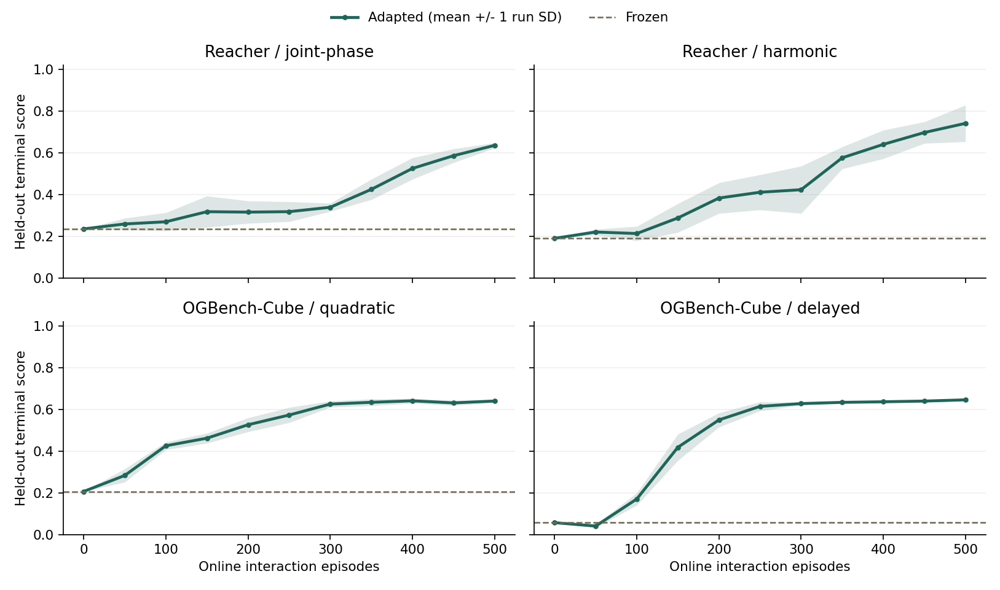
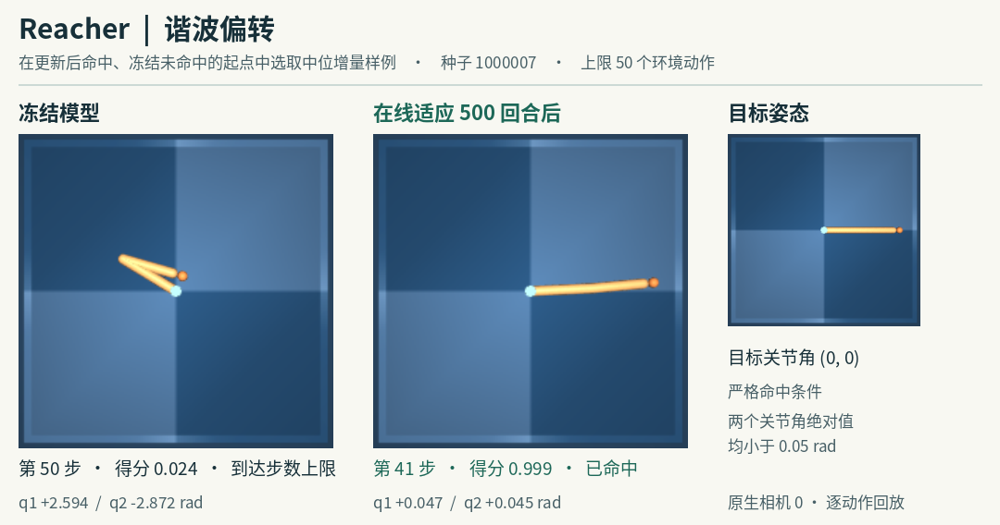
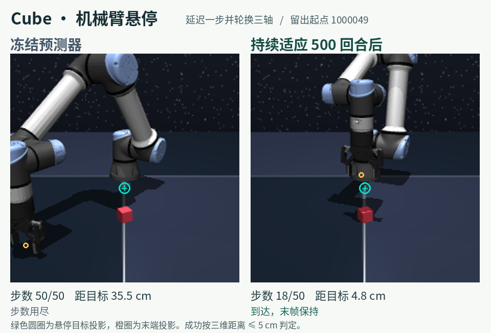

# Reacher and OGBench-Cube reproduction

[Download the 47-second paired video](https://github.com/ZhengQingJing/jepa-ttt-reproduction/releases/download/v1.1.0/arm-paired.mp4) · [Download the offline video report (Chinese)](https://github.com/ZhengQingJing/jepa-ttt-reproduction/releases/download/v1.1.0/arm-reproduction.html) · [All v1.1.0 assets and checksums](https://github.com/ZhengQingJing/jepa-ttt-reproduction/releases/tag/v1.1.0)

Reacher moves a planar arm to joint angles (0, 0). A hit requires both wrapped joint angles to have magnitude below 0.05 radians. OGBench-Cube moves the UR5e end effector to a point 10 cm above the red cube. Entering a 5 cm radius around the goal counts as a hit.

## Formal results

Each condition uses three 500-episode deployments from the same offline checkpoint. Every 50 episodes, the current model is evaluated on the same 100 held-out starts. Best score is the peak of the three-run mean curve after deployment begins. The reported standard deviation is across the three scores at that checkpoint. The hit-rate column compares the frozen controller with the controller after episode 500.

| Task and shift | Frozen score | Best adapted score | Paper best | Goal hits, frozen → adapted | Five-block prediction MSE reduction |
|---|---:|---:|---:|---:|---:|
| [Reacher, joint phase](../additional/reacher/joint-phase/) | 0.235 | 0.635 ± 0.013 | 0.758 | 21.0% → 25.0% | 86.39% |
| [Reacher, harmonic](../additional/reacher/harmonic/) | 0.190 | 0.741 ± 0.088 | 0.688 | 15.0% → 30.7% | 84.95% |
| [Cube, quadratic crosstalk](../additional/cube/quadratic/) | 0.206 | 0.641 ± 0.012 | 0.628 | 26.0% → 98.3% | 90.22% |
| [Cube, delayed cyclic](../additional/cube/delayed/) | 0.057 | 0.645 ± 0.003 | 0.643 | 0.0% → 100.0% | 94.47% |

Both Cube best scores are close to the paper values. The delayed-action frozen score is lower here (0.057 versus 0.172). Reacher's joint-phase best score is lower than the paper by 0.123, while harmonic is higher by 0.053. The full-curve Reacher AUCs are 0.379 and 0.431, compared with 0.619 and 0.518 in the paper. See the [full comparisons](../additional-measurements.md) and [paper](https://arxiv.org/html/2610.00722v1#S10).



## What the videos show

The montage shows the same start on both sides of each clip, with frozen planning on the left and the adapted controller on the right. Each arm condition has an example selected near the median paired score gain. The two extra Reacher clips select examples from starts where only the adapted model reaches the goal. Video overlays are applied after planning. The offline HTML includes the starting and final results, the learning curves and additional early-stage clips.

| Reacher, harmonic | Cube, delayed cyclic |
|---|---|
|  |  |
| Selected success example. The adapted arm reached the target at step 41. | Median-gain example from the independent repeat. The adapted arm reached the target at step 18. |

The Reacher video predictors match the archived episode-500 parameter digests for joint-phase run 2 and harmonic run 1. The two Cube video predictors come from independent repeats of deployment seed 0. Their episode-500 parameter digests differ from the original seed-0 archive. On a fresh evaluation of the same 100 starts they achieved mean scores of 0.6379 and 0.6427, both with a 100% hit rate. The formal results table above uses the original three deployments per shift. Replaying the recorded commands reproduced the compared native RGB frames and simulator states for all six final clips.

## Repeat the experiments

1. Use the v1.1.0 checkout and set up the [pinned upstream dependencies](../../scripts/setup_upstream.py). Follow the task instructions for [Reacher](../../experiments/reacher/README.md) and [Cube](../../experiments/cube/README.md). Reacher pretraining used 3,000 episodes of 200 observations. Cube used 3,000 episodes of 50 observations.
2. Train the world model for 20 epochs and fit the offline reward head, or extract the released checkpoints at the repository root. The online planner receives camera images and commanded actions. It looks ahead 25 environment steps and executes 5 before replanning. Every 64 new dense windows schedule one predictor update, giving 250 updates per deployment. The visual encoder and reward head remain fixed.
3. Run frozen evaluation, then the three deployment seeds for each shift. To recompute the published statistics from Git alone, use the commands below from the checkout root.

```bash
for condition in reacher/joint-phase reacher/harmonic cube/quadratic cube/delayed; do
  python scripts/summarize_benchmark.py "results/additional/$condition"
done
```

To download the binary artifacts with the GitHub CLI and check them before use:

```bash
mkdir -p arm-assets
gh release download v1.1.0 --repo ZhengQingJing/jepa-ttt-reproduction --dir arm-assets
(cd arm-assets && sha256sum -c SHA256SUMS)
tar -xzf arm-assets/arm-checkpoints.tar.gz
```

The [Reacher action replay](../../experiments/reacher/replay/) and [Cube action replay](../../experiments/cube/replay/) instructions show how to drive the native simulators from the saved commands and verify the recorded states.

The release includes the offline video report, the montage, per-episode replay evidence, and compact offline trajectory arrays. The linked task collectors generate native RGB training frames. [Download the release](https://github.com/ZhengQingJing/jepa-ttt-reproduction/releases/tag/v1.1.0).
